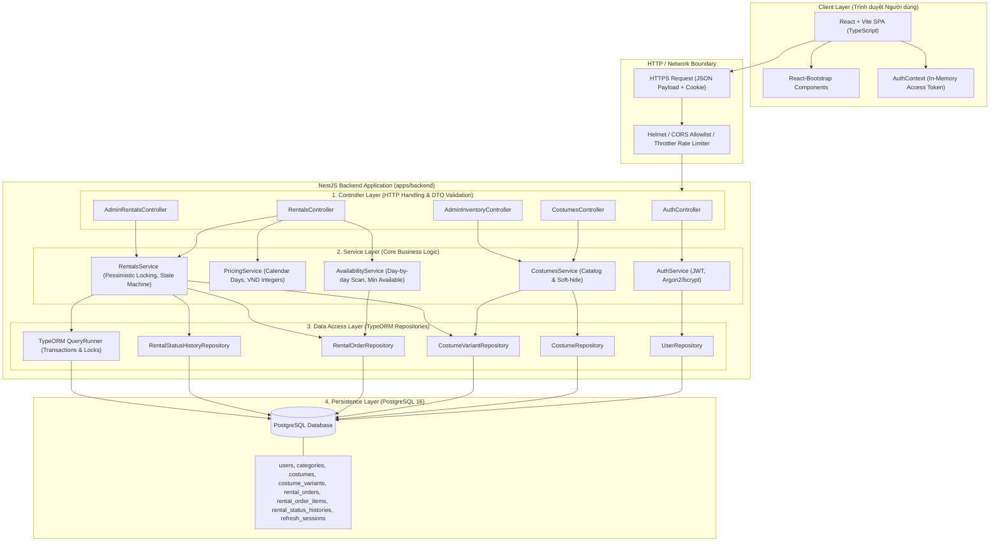
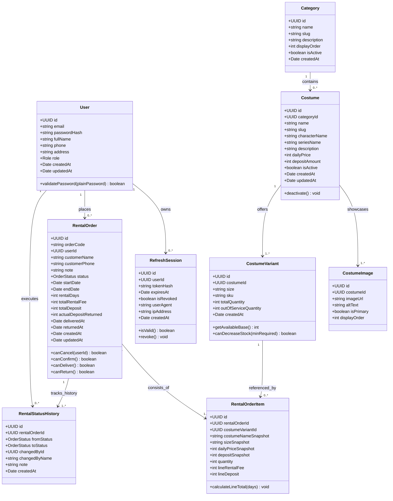
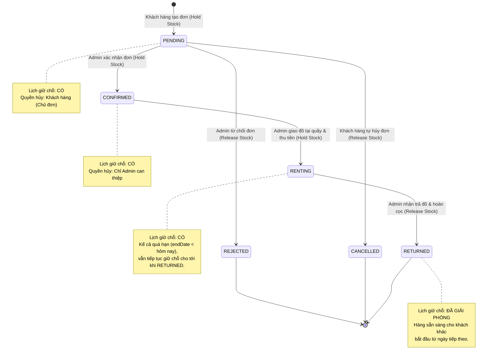
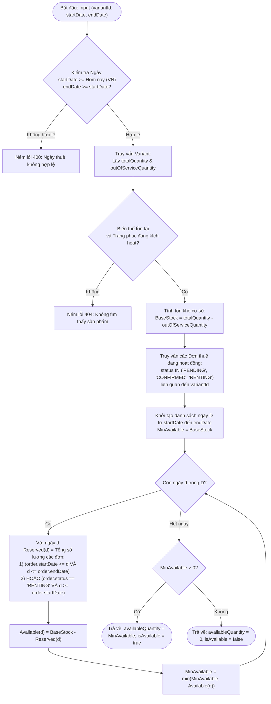
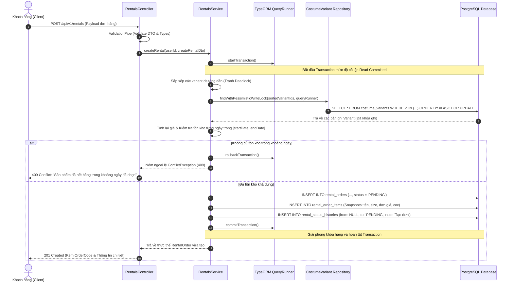

# Tài Liệu Thiết Kế Kiến Trúc Hệ Thống (System Architecture Document)
**Dự án: CosRent – Hệ Thống Cho Thuê Trang Phục & Đồ Cosplay**
*Mã tài liệu: DOC-ARCH-01 | Phiên bản: 1.0.0*

---

## 1. Tổng Quan Kiến Trúc (Architecture Overview)

CosRent được thiết kế theo mô hình **Phân lớp Hướng Dịch Vụ (Layered Architecture)** kết hợp với chuẩn **RESTful API** và **Kiến trúc SPA (Single Page Application)**. Mô hình này tách biệt hoàn toàn giữa tầng giao diện hiển thị phía Client và tầng xử lý nghiệp vụ, quản lý dữ liệu phía Server.

### 1.1. Sơ đồ Tổng thể Hệ thống

---

## 2. Nguyên Tắc Phân Lớp Backend (Separation of Concerns)

Nhằm đảm bảo tính module hóa, dễ kiểm thử (testability) và tuân thủ các nguyên lý SOLID, Backend NestJS được chia thành 4 tầng rõ rệt:

1. **Controller Layer (Tầng Điều Khiển)**:
   - Nhiệm vụ duy nhất: Tiếp nhận yêu cầu HTTP, điều hướng URL, bóc tách DTO, kích hoạt xác thực (`Guards`), thực hiện validation dữ liệu đầu vào qua `ValidationPipe` (`class-validator`), và trả về mã trạng thái HTTP chuẩn (200, 201, 400, 401, 403, 404, 409).
   - **Tuyệt đối không** chứa logic nghiệp vụ tính toán giá, kiểm tra tồn kho hay truy vấn SQL trực tiếp trong Controller.

2. **Service Layer (Tầng Nghiệp Vụ Cốt Lõi)**:
   - Chứa toàn bộ các quy tắc nghiệp vụ (Business Rules): Tính toán số ngày theo lịch Việt Nam, tính tiền thuê và tiền cọc, thuật toán quét lịch tồn kho khả dụng, kiểm tra trạng thái đơn hợp lệ, quản lý transaction và cơ chế khóa hàng.
   - Gọi đến các Repositories để đọc và ghi dữ liệu. Độc lập với giao thức truyền thông HTTP, giúp dễ dàng viết Unit Test độc lập.

3. **Repository / Data Access Layer (Tầng Truy Cập Dữ Liệu)**:
   - Đảm nhiệm việc trừu tượng hóa các câu lệnh SQL thông qua TypeORM Repository và `QueryBuilder`.
   - Thực hiện các truy vấn phức tạp: JOIN bảng, tính tổng số lượng đặt theo ngày, khóa bi quan hàng (`setLock('pessimistic_write')`), phân trang và sắp xếp an toàn.

4. **Database Layer (Tầng Cơ Sở Dữ Liệu)**:
   - Lưu trữ dữ liệu quan hệ trong PostgreSQL 16.
   - Đảm bảo toàn vẹn dữ liệu với các ràng buộc khóa ngoại (Foreign Keys), khóa chính (Primary Keys), chỉ mục tìm kiếm (B-Tree Indexes) và cờ kiểm tra (Check Constraints).

---

## 3. Sơ Đồ Lớp UML Chi Tiết (UML Class Diagram)

Sơ đồ thể hiện đầy đủ các thuộc tính, phương thức chính và quan hệ với multiplicity giữa các thực thể cốt lõi:

---

## 4. Máy Trạng Thái Đơn Hàng (Rental Order State Machine)

Vòng đời của đơn thuê trang phục tuân thủ nghiêm ngặt các quy tắc chuyển đổi có điều kiện. Mọi chuyển đổi ngoài danh mục này đều bị hệ thống chặn lại với lỗi 400 Bad Request.

---

## 5. Thuật Toán Kiểm Tra Tồn Kho Theo Khoảng Ngày (Availability Algorithm)

Quy tắc:
1. Đơn giữ tồn kho: `PENDING`, `CONFIRMED`, `RENTING`.
2. Đơn `RENTING` quá hạn: Nếu $d > \text{endDate}$ nhưng đơn vẫn ở trạng thái `RENTING`, đồ chưa được trả về kho, do đó đơn này tiếp tục tính là chiếm dụng tồn kho tại ngày $d$.
3. Quét từng ngày $d \in [\text{startDate}, \text{endDate}]$:
   - $\text{Reserved}(d) = \sum \text{quantity}$ của các đơn chiếm dụng bao trùm ngày $d$.
   - $\text{Available}(d) = \text{totalQuantity} - \text{outOfServiceQuantity} - \text{Reserved}(d)$.
4. Lượng có thể thuê = $\min_{d \in [\text{startDate}, \text{endDate}]} \text{Available}(d)$.

---

## 6. Sơ Đồ Tuần Tự Tạo Đơn An Toàn Đồng Thời (Concurrent Checkout Sequence)

Để đảm bảo không bị vượt quá số lượng tồn kho (Overselling) khi nhiều khách hàng cùng đặt hàng trong cùng một tích tắc, hệ thống áp dụng cơ chế khóa bi quan (Pessimistic Locking):

