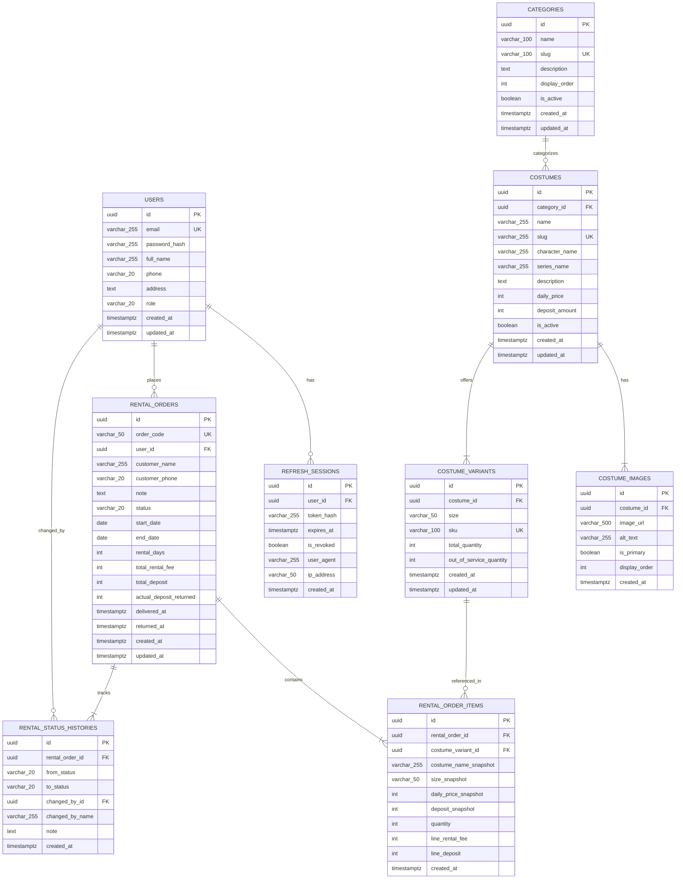

# Tài Liệu Thiết Kế Cơ Sở Dữ Liệu (Database Design & Specification)
**Dự án: CosRent – Hệ Thống Cho Thuê Trang Phục & Đồ Cosplay**
*Mã tài liệu: DOC-DB-01 | Phiên bản: 1.0.0*

---

## 1. Tổng Quan Cơ Sở Dữ Liệu (Database Overview)

Hệ thống CosRent sử dụng Hệ quản trị cơ sở dữ liệu quan hệ **PostgreSQL 16**. Thiết kế cơ sở dữ liệu tuân thủ chuẩn hóa dạng 3 (3NF), đảm bảo tính toàn vẹn tham chiếu, tối ưu hóa truy vấn lọc theo lịch và bảo vệ dữ liệu lịch sử tài chính bằng kỹ thuật lưu vết ảnh chụp (Snapshotting).

### 1.1. Sơ Đồ Quan Hệ Thực Thể (Entity Relationship Diagram - ERD)



---

## 2. Đặc Tả Chi Tiết Các Bảng Dữ Liệu (Table Schema Specification)

### 2.1. Bảng `users` (Người dùng)
Lưu trữ thông tin tài khoản khách hàng và quản trị viên.

| Tên Cột | Kiểu Dữ Liệu | Ràng Buộc | Mô Tả |
| :--- | :--- | :--- | :--- |
| `id` | `UUID` | PK, `gen_random_uuid()` | Khóa chính duy nhất |
| `email` | `VARCHAR(255)` | NOT NULL, UNIQUE | Địa chỉ email đăng nhập |
| `password_hash` | `VARCHAR(255)` | NOT NULL | Chuỗi băm mật khẩu (Argon2id/bcrypt) |
| `full_name` | `VARCHAR(255)` | NOT NULL | Họ và tên người dùng |
| `phone` | `VARCHAR(20)` | NOT NULL | Số điện thoại liên hệ |
| `address` | `TEXT` | NULL | Địa chỉ liên hệ của khách hàng |
| `role` | `VARCHAR(20)` | NOT NULL, DEFAULT `'CUSTOMER'` | Phân quyền: `CUSTOMER` hoặc `ADMIN` |
| `created_at` | `TIMESTAMPTZ` | NOT NULL, DEFAULT `NOW()` | Thời điểm tạo tài khoản |
| `updated_at` | `TIMESTAMPTZ` | NOT NULL, DEFAULT `NOW()` | Thời điểm cập nhật gần nhất |

- **Chỉ mục (Indexes)**:
  - `idx_users_email`: B-Tree trên `email` (Unique).
  - `idx_users_role`: B-Tree trên `role`.

---

### 2.2. Bảng `refresh_sessions` (Phiên làm việc & Token xoay vòng)
Lưu hash của Refresh Token để quản lý thu hồi (Revocation) và chống tấn công Replay.

| Tên Cột | Kiểu Dữ Liệu | Ràng Buộc | Mô Tả |
| :--- | :--- | :--- | :--- |
| `id` | `UUID` | PK, `gen_random_uuid()` | Khóa chính |
| `user_id` | `UUID` | NOT NULL, FK $\rightarrow$ `users(id)` ON DELETE CASCADE | Người sở hữu phiên |
| `token_hash` | `VARCHAR(255)` | NOT NULL, UNIQUE | SHA-256 hash của refresh token |
| `expires_at` | `TIMESTAMPTZ` | NOT NULL | Thời điểm hết hạn token |
| `is_revoked` | `BOOLEAN` | NOT NULL, DEFAULT `FALSE` | Đánh dấu đã bị thu hồi |
| `user_agent` | `VARCHAR(255)` | NULL | Thông tin trình duyệt/thiết bị |
| `ip_address` | `VARCHAR(50)` | NULL | Địa chỉ IP đăng nhập |
| `created_at` | `TIMESTAMPTZ` | NOT NULL, DEFAULT `NOW()` | Thời điểm khởi tạo phiên |

- **Chỉ mục**: `idx_refresh_sessions_user_id`, `idx_refresh_sessions_token_hash`.

---

### 2.3. Bảng `categories` (Danh mục trang phục)

| Tên Cột | Kiểu Dữ Liệu | Ràng Buộc | Mô Tả |
| :--- | :--- | :--- | :--- |
| `id` | `UUID` | PK, `gen_random_uuid()` | Khóa chính |
| `name` | `VARCHAR(100)` | NOT NULL | Tên danh mục (ví dụ: Anime, Game, Cổ phong) |
| `slug` | `VARCHAR(100)` | NOT NULL, UNIQUE | Đường dẫn thân thiện SEO |
| `description` | `TEXT` | NULL | Mô tả tóm tắt |
| `display_order` | `INT` | NOT NULL, DEFAULT `0` | Thứ tự ưu tiên hiển thị |
| `is_active` | `BOOLEAN` | NOT NULL, DEFAULT `TRUE` | Cờ ẩn/hiện danh mục |
| `created_at` | `TIMESTAMPTZ` | NOT NULL, DEFAULT `NOW()` | Ngày tạo |
| `updated_at` | `TIMESTAMPTZ` | NOT NULL, DEFAULT `NOW()` | Ngày cập nhật |

---

### 2.4. Bảng `costumes` (Trang phục cosplay)

| Tên Cột | Kiểu Dữ Liệu | Ràng Buộc | Mô Tả |
| :--- | :--- | :--- | :--- |
| `id` | `UUID` | PK, `gen_random_uuid()` | Khóa chính |
| `category_id` | `UUID` | NOT NULL, FK $\rightarrow$ `categories(id)` ON DELETE RESTRICT | Danh mục trực thuộc |
| `name` | `VARCHAR(255)` | NOT NULL | Tên trang phục |
| `slug` | `VARCHAR(255)` | NOT NULL, UNIQUE | Đường dẫn URL |
| `character_name`| `VARCHAR(255)` | NULL | Tên nhân vật (ví dụ: Raiden Shogun, Anya) |
| `series_name` | `VARCHAR(255)` | NULL | Tên tác phẩm/Game (ví dụ: Genshin Impact) |
| `description` | `TEXT` | NOT NULL | Mô tả chi tiết chất liệu, phụ kiện đi kèm |
| `daily_price` | `INT` | NOT NULL, CHECK (`daily_price >= 0`) | Giá thuê mỗi ngày (VND) |
| `deposit_amount`| `INT` | NOT NULL, CHECK (`deposit_amount >= 0`) | Tiền cọc quy định mỗi bộ (VND) |
| `is_active` | `BOOLEAN` | NOT NULL, DEFAULT `TRUE` | Cờ kích hoạt (Ẩn nếu đã có đơn cũ) |
| `created_at` | `TIMESTAMPTZ` | NOT NULL, DEFAULT `NOW()` | Ngày tạo |
| `updated_at` | `TIMESTAMPTZ` | NOT NULL, DEFAULT `NOW()` | Ngày sửa |

- **Chỉ mục**: `idx_costumes_category_id`, `idx_costumes_is_active`, `idx_costumes_slug`, `idx_costumes_daily_price`.

---

### 2.5. Bảng `costume_images` (Hình ảnh sản phẩm)

| Tên Cột | Kiểu Dữ Liệu | Ràng Buộc | Mô Tả |
| :--- | :--- | :--- | :--- |
| `id` | `UUID` | PK, `gen_random_uuid()` | Khóa chính |
| `costume_id` | `UUID` | NOT NULL, FK $\rightarrow$ `costumes(id)` ON DELETE CASCADE | Thuộc trang phục nào |
| `image_url` | `VARCHAR(500)` | NOT NULL | Đường dẫn URL ảnh |
| `alt_text` | `VARCHAR(255)` | NOT NULL | Chú thích ảnh cho trình đọc màn hình |
| `is_primary` | `BOOLEAN` | NOT NULL, DEFAULT `FALSE` | Ảnh đại diện chính |
| `display_order` | `INT` | NOT NULL, DEFAULT `0` | Thứ tự hiển thị trong gallery |
| `created_at` | `TIMESTAMPTZ` | NOT NULL, DEFAULT `NOW()` | Ngày tạo |

---

### 2.6. Bảng `costume_variants` (Biến thể kích cỡ & Tồn kho)

| Tên Cột | Kiểu Dữ Liệu | Ràng Buộc | Mô Tả |
| :--- | :--- | :--- | :--- |
| `id` | `UUID` | PK, `gen_random_uuid()` | Khóa chính |
| `costume_id` | `UUID` | NOT NULL, FK $\rightarrow$ `costumes(id)` ON DELETE CASCADE | Thuộc trang phục nào |
| `size` | `VARCHAR(50)` | NOT NULL | Kích cỡ (S, M, L, XL, FreeSize,...) |
| `sku` | `VARCHAR(100)` | NOT NULL, UNIQUE | Mã quản lý kho hàng duy nhất |
| `total_quantity`| `INT` | NOT NULL, CHECK (`total_quantity >= 0`) | Tổng số lượng trang phục sở hữu |
| `out_of_service_quantity` | `INT` | NOT NULL, DEFAULT `0`, CHECK (`out_of_service_quantity >= 0`) | Số lượng hỏng/đang giặt sấy/sửa chữa |
| `created_at` | `TIMESTAMPTZ` | NOT NULL, DEFAULT `NOW()` | Ngày tạo |
| `updated_at` | `TIMESTAMPTZ` | NOT NULL, DEFAULT `NOW()` | Ngày sửa |

- **Ràng buộc kiểm tra bổ sung**: `CHECK (total_quantity >= out_of_service_quantity)`.
- **Chỉ mục**: `idx_costume_variants_costume_id`, `idx_costume_variants_sku`.

---

### 2.7. Bảng `rental_orders` (Đơn thuê trang phục)

| Tên Cột | Kiểu Dữ Liệu | Ràng Buộc | Mô Tả |
| :--- | :--- | :--- | :--- |
| `id` | `UUID` | PK, `gen_random_uuid()` | Khóa chính |
| `order_code` | `VARCHAR(50)` | NOT NULL, UNIQUE | Mã hiển thị thân thiện (VD: CR-20261029-XXXX) |
| `user_id` | `UUID` | NOT NULL, FK $\rightarrow$ `users(id)` ON DELETE RESTRICT | Khách hàng đặt đơn |
| `customer_name` | `VARCHAR(255)` | NOT NULL | Tên người nhận đồ tại cửa hàng |
| `customer_phone`| `VARCHAR(20)` | NOT NULL | Số điện thoại liên hệ nhận đồ |
| `note` | `TEXT` | NULL | Ghi chú yêu cầu của khách hàng |
| `status` | `VARCHAR(20)` | NOT NULL, DEFAULT `'PENDING'` | `PENDING`, `CONFIRMED`, `RENTING`, `RETURNED`, `CANCELLED`, `REJECTED` |
| `start_date` | `DATE` | NOT NULL | Ngày nhận trang phục tại cửa hàng |
| `end_date` | `DATE` | NOT NULL | Ngày hoàn trả trang phục tại cửa hàng |
| `rental_days` | `INT` | NOT NULL, CHECK (`rental_days >= 1`) | Số ngày thuê = (end_date - start_date) + 1 |
| `total_rental_fee` | `INT` | NOT NULL, CHECK (`total_rental_fee >= 0`) | Tổng tiền thuê tính theo số ngày (VND) |
| `total_deposit` | `INT` | NOT NULL, CHECK (`total_deposit >= 0`) | Tổng tiền đặt cọc quy định (VND) |
| `actual_deposit_returned` | `INT` | NULL, DEFAULT `0` | Tiền cọc thực tế hoàn trả sau khi kiểm đồ |
| `delivered_at` | `TIMESTAMPTZ` | NULL | Thời điểm Admin bàn giao đồ |
| `returned_at` | `TIMESTAMPTZ` | NULL | Thời điểm Admin nhận đồ trả |
| `created_at` | `TIMESTAMPTZ` | NOT NULL, DEFAULT `NOW()` | Ngày tạo đơn |
| `updated_at` | `TIMESTAMPTZ` | NOT NULL, DEFAULT `NOW()` | Ngày cập nhật |

- **Ràng buộc kiểm tra ngày**: `CHECK (end_date >= start_date)`.
- **Chỉ mục**: `idx_rental_orders_user_id`, `idx_rental_orders_status`, `idx_rental_orders_dates` (`start_date`, `end_date`), `idx_rental_orders_order_code`.

---

### 2.8. Bảng `rental_order_items` (Chi tiết dòng đơn thuê & Snapshot)

| Tên Cột | Kiểu Dữ Liệu | Ràng Buộc | Mô Tả |
| :--- | :--- | :--- | :--- |
| `id` | `UUID` | PK, `gen_random_uuid()` | Khóa chính |
| `rental_order_id` | `UUID` | NOT NULL, FK $\rightarrow$ `rental_orders(id)` ON DELETE CASCADE | Đơn thuê cha |
| `costume_variant_id` | `UUID` | NOT NULL, FK $\rightarrow$ `costume_variants(id)` ON DELETE RESTRICT | Biến thể kích cỡ được thuê |
| `costume_name_snapshot` | `VARCHAR(255)` | NOT NULL | Tên trang phục chụp tại thời điểm đặt |
| `size_snapshot` | `VARCHAR(50)` | NOT NULL | Tên kích cỡ chụp tại thời điểm đặt |
| `daily_price_snapshot` | `INT` | NOT NULL | Đơn giá/ngày chụp tại thời điểm đặt (VND) |
| `deposit_snapshot` | `INT` | NOT NULL | Tiền cọc/bộ chụp tại thời điểm đặt (VND) |
| `quantity` | `INT` | NOT NULL, CHECK (`quantity >= 1`) | Số lượng bộ thuê |
| `line_rental_fee` | `INT` | NOT NULL | Tiền thuê dòng = đơn giá * ngày * số lượng |
| `line_deposit` | `INT` | NOT NULL | Tiền cọc dòng = cọc/bộ * số lượng |
| `created_at` | `TIMESTAMPTZ` | NOT NULL, DEFAULT `NOW()` | Ngày tạo |

---

### 2.9. Bảng `rental_status_histories` (Lịch sử chuyển đổi trạng thái)

| Tên Cột | Kiểu Dữ Liệu | Ràng Buộc | Mô Tả |
| :--- | :--- | :--- | :--- |
| `id` | `UUID` | PK, `gen_random_uuid()` | Khóa chính |
| `rental_order_id` | `UUID` | NOT NULL, FK $\rightarrow$ `rental_orders(id)` ON DELETE CASCADE | Đơn thuê liên kết |
| `from_status` | `VARCHAR(20)` | NULL | Trạng thái trước (NULL khi tạo đơn mới) |
| `to_status` | `VARCHAR(20)` | NOT NULL | Trạng thái sau chuyển đổi |
| `changed_by_id` | `UUID` | NOT NULL, FK $\rightarrow$ `users(id)` ON DELETE RESTRICT | Người thực hiện thao tác |
| `changed_by_name` | `VARCHAR(255)` | NOT NULL | Họ tên người thực hiện (Snapshot) |
| `note` | `TEXT` | NULL | Ghi chú lý do chuyển đổi / biên bản kiểm đồ |
| `created_at` | `TIMESTAMPTZ` | NOT NULL, DEFAULT `NOW()` | Thời điểm ghi nhận vết lịch sử |

---

## 3. Chiến Lược Migrations vs Synchronize

- **Cấm dùng `synchronize: true` trong môi trường sản xuất**: Cờ `synchronize` tự động dò quét metadata của TypeORM và sửa đổi trực tiếp bảng trên database. Điều này tiềm ẩn nguy cơ cực lớn làm rớt cột (`DROP COLUMN`), mất dữ liệu giao dịch hoặc gây khóa chết bảng trong quá trình ứng dụng đang chạy.
- **Tuân thủ quy trình Migration chuẩn**:
  1. Mọi thay đổi schema đều được viết thành file TypeScript Migration có 2 phương thức: `up(queryRunner)` và `down(queryRunner)`.
  2. Bảng `migrations` của TypeORM lưu trữ dấu vết các file migration đã thực thi.
  3. Khi khởi động container sản xuất, lệnh `npm run migration:run` được thực thi trước khi server Node.js lắng nghe kết nối.

---

## 4. Các Ví Dụ Truy Vấn Thực Tế Từ Mã Nguồn (SQL in Action)

### 4.1. Khóa Bi Quan Khi Tạo Đơn (Pessimistic Write Lock)
Trích từ phương thức `createOrder` trong `RentalsService`:
```sql
SELECT * FROM costume_variants
WHERE id IN ($1, $2)
ORDER BY id ASC
FOR UPDATE;
```
*Mục đích*: Khóa các hàng biến thể theo thứ tự ID ổn định tăng dần, ngăn chặn các transaction chạy song song sửa đổi hoặc đặt hàng vượt quá số lượng, đồng thời triệt tiêu nguy cơ xảy ra Deadlock.

### 4.2. Truy Vấn Tính Số Lượng Chiếm Chỗ Theo Ngày Lịch (Availability Scan Query)
```sql
SELECT 
    oi.costume_variant_id,
    oi.quantity,
    ro.status,
    ro.start_date,
    ro.end_date
FROM rental_order_items oi
JOIN rental_orders ro ON oi.rental_order_id = ro.id
WHERE oi.costume_variant_id = $1
  AND ro.status IN ('PENDING', 'CONFIRMED', 'RENTING')
  AND (
      -- Đơn thông thường giao nhau với khoảng ngày yêu cầu
      (ro.start_date <= $3 AND ro.end_date >= $2)
      OR
      -- Đơn RENTING quá hạn chưa trả vẫn tiếp tục chiếm dụng kho
      (ro.status = 'RENTING' AND ro.start_date <= $3)
  );
```

### 4.3. Kiểm Tra Giảm Tồn Kho An Toàn (Inventory Safety Guard)
Khi Admin giảm số lượng `total_quantity` của một biến thể, hệ thống chạy truy vấn tìm ngày có số lượng cam kết lớn nhất trong tương lai:
```sql
SELECT 
    MAX(daily_reserved.reserved_sum) AS peak_reserved
FROM (
    SELECT 
        d.day,
        SUM(oi.quantity) AS reserved_sum
    FROM generate_series($1::date, $2::date, '1 day'::interval) d(day)
    JOIN rental_orders ro ON (
        ro.status IN ('PENDING', 'CONFIRMED', 'RENTING')
        AND (
            (ro.start_date <= d.day AND ro.end_date >= d.day)
            OR (ro.status = 'RENTING' AND ro.start_date <= d.day)
        )
    )
    JOIN rental_order_items oi ON oi.rental_order_id = ro.id
    WHERE oi.costume_variant_id = $3
    GROUP BY d.day
) daily_reserved;
```
Nếu `new_total_quantity - out_of_service < peak_reserved`, hệ thống lập tức từ chối và cảnh báo Admin.
